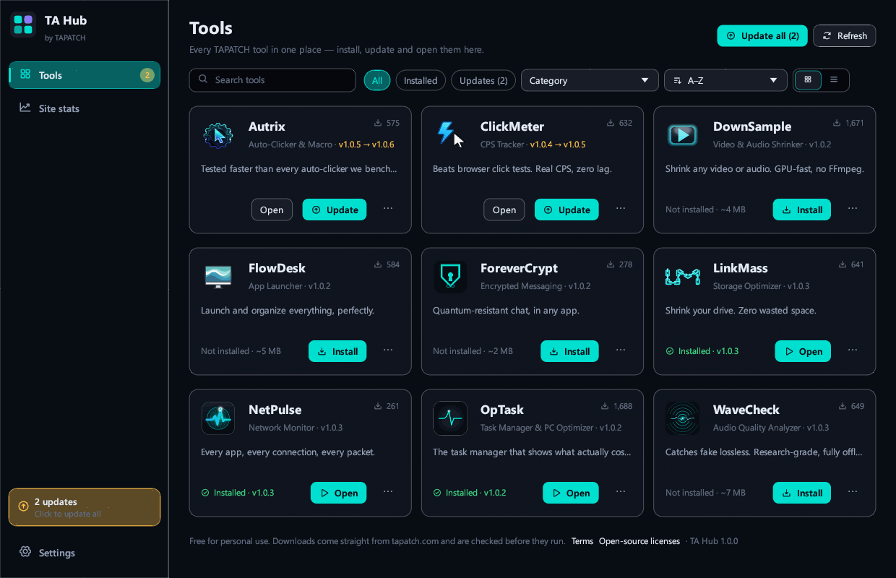
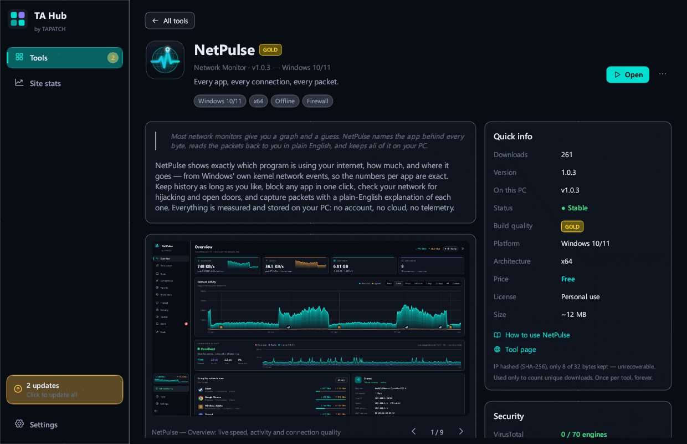
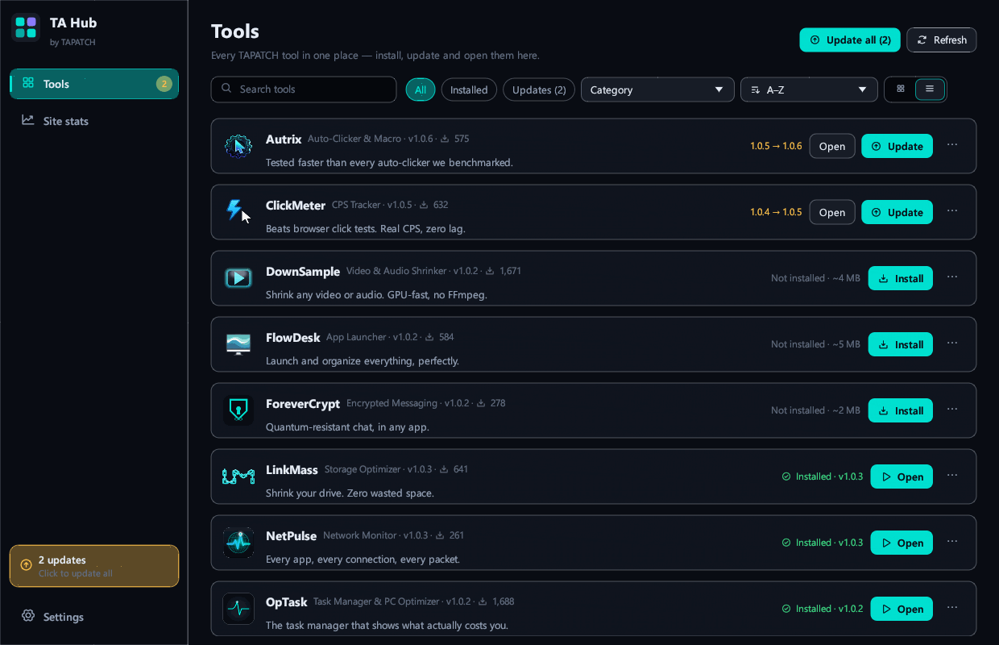
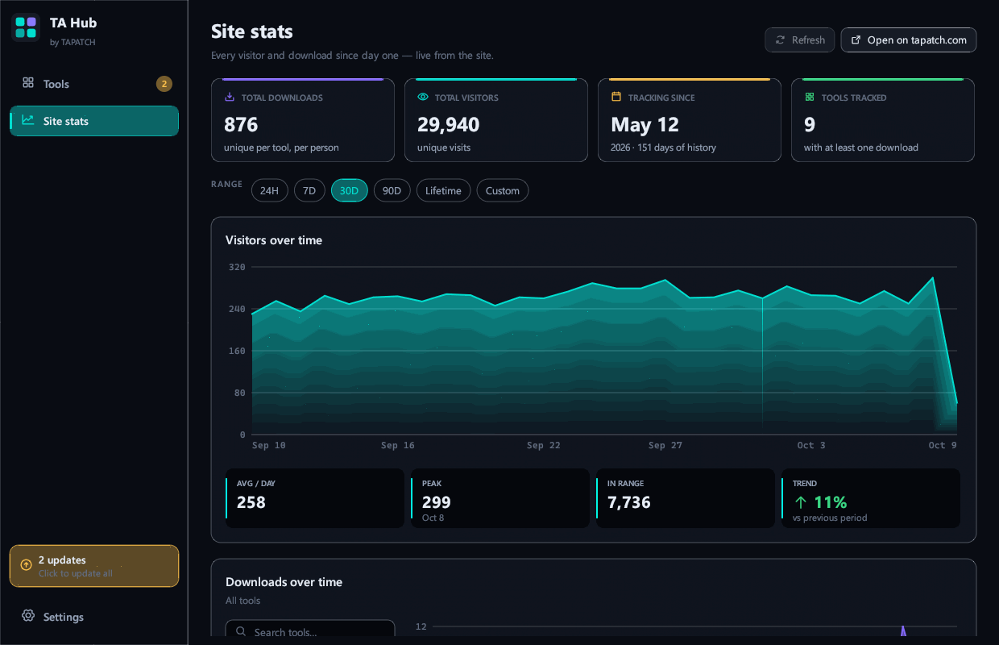
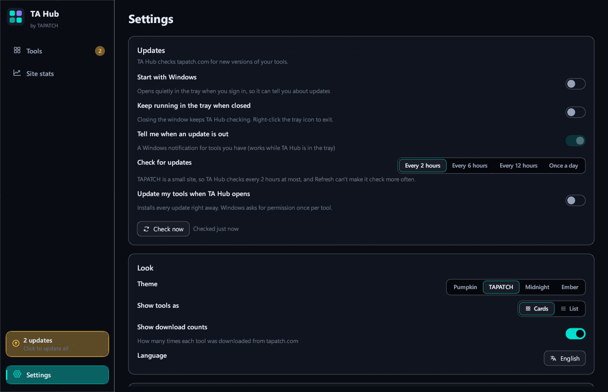

<p align="center"></p>
<h1 align="center">TA Hub</h1>
<p align="center"><b>Every TAPATCH tool in one app.</b></p>
<p align="center">App Manager · Windows 10/11 · x64 · ~3 MB · Free for personal use</p>
<p align="center"><a href="https://github.com/tapatchUSA/TAHub/releases/latest"><b>⬇ Download TA Hub 1.0.1</b></a> &nbsp;·&nbsp; <a href="https://tapatch.com/tools/tahub/">tapatch.com/tools/tahub</a></p>

<p align="center">
<br>
 <br>
 
</p>

> Checking a website for updates gets old. TA Hub keeps every TAPATCH tool in one window, installs any of them in one click, and tells you when a new version comes out.

## What it does

TA Hub lists every TAPATCH tool with its screenshots, videos, release notes and download count, the same as its page on tapatch.com. Install any tool in one click, update everything at once, open, reinstall or uninstall them, or go back to an older version. New tools show up by themselves, and TA Hub can wait in the tray and tell you when a tool you have gets an update. Every installer comes straight from tapatch.com and only runs if TAPATCH's signature vouches for it.

## Features

Install, update and open every TAPATCH tool from one small app, and never miss a release.

**🧰 Every tool in one window**  
Each TAPATCH tool with its screenshots, videos, release notes, questions and download count — the same as its page on tapatch.com, in your language.

**⬇️ One-click installs and updates**  
Install any tool, update one or all of them at once, then open, reinstall or uninstall them. Need an older version? Pick it from the tool's menu.

**🔔 Never miss a release**  
New tools show up by themselves. Keep TA Hub in the tray and it tells you when a tool you have gets an update.

**🛡️ Signed, checked downloads**  
Installers come only from tapatch.com and only run if TAPATCH's signed list vouches for them, so not even a hacked website could slip a bad file through.

**📈 The site's stats, live**  
Visitors, downloads, where people come from and who's on the site right now — the same numbers as the Stats page.

**🌐 10 languages, 4 themes**  
English, Chinese, Russian, Spanish, Portuguese, German, Japanese, French, Polish and Korean, with TAPATCH, Midnight, Ember and Pumpkin themes.

## Limitations

- Windows 10/11 only. Installing or updating a tool asks Windows for administrator permission, once per tool. TA Hub needs the internet to check for updates and download tools; offline, it shows the list it saved last time.

## What's new in 1.0.1

- Now runs on any Windows 10 or 11 PC, even a fresh install: it no longer needs the Microsoft Visual C++ Redistributable (no more "VCRUNTIME140.dll was not found")
- Nothing else changed

Release notes for every version are on the [Releases](https://github.com/tapatchUSA/TAHub/releases) page and in [release-notes/](release-notes/).

## Install

1. Download **TAHub-Setup-1.0.1.exe** from the [latest release](https://github.com/tapatchUSA/TAHub/releases/latest) or from [tapatch.com](https://tapatch.com/tools/tahub/).
2. Run it. The installer and the app come in 10 languages.
3. Accept the Terms of Service on first launch.

Windows may show a SmartScreen warning for new downloads. Click **More info → Run anyway**.

Or with [Scoop](https://scoop.sh):

```powershell
scoop bucket add tapatch https://github.com/tapatchUSA/packages
scoop install tapatch/tahub
```

## All versions

| Version | Released | Installer | VirusTotal | SHA-256 |
|---|---|---|---|---|
| [1.0.1](https://github.com/tapatchUSA/TAHub/releases/tag/v1.0.1) | 2026-10-17 | [TAHub-Setup-1.0.1.exe](https://github.com/tapatchUSA/TAHub/releases/download/v1.0.1/TAHub-Setup-1.0.1.exe) | [1 / 71](https://www.virustotal.com/gui/file/34a8e9d807a1238a7b6a90ff5c9f65cc4f1ff8199b9d41a7b1a4fd4a5c78a979/detection) | `34a8e9d807a1238a…` |
| [1.0.0](https://github.com/tapatchUSA/TAHub/releases/tag/v1.0.0) | 2026-10-17 | [TAHub-Setup-1.0.0.exe](https://github.com/tapatchUSA/TAHub/releases/download/v1.0.0/TAHub-Setup-1.0.0.exe) | [1 / 71](https://www.virustotal.com/gui/file/e79301a2df2775ea90b6f80eea635d07b5d75212546e71047e13f35bcba0c945/detection) | `e79301a2df2775ea…` |

## Security

Every installer is scanned on VirusTotal before release. TA Hub 1.0.1: **1 / 71** engines flag it · [view report](https://www.virustotal.com/gui/file/34a8e9d807a1238a7b6a90ff5c9f65cc4f1ff8199b9d41a7b1a4fd4a5c78a979/detection)

**SHA-256**
```
34a8e9d807a1238a7b6a90ff5c9f65cc4f1ff8199b9d41a7b1a4fd4a5c78a979
```

## Built with

Rust · egui · WinHTTP · Windows CNG

## License

Free for personal use. Business or commercial use requires a paid license (see [tapatch.com/terms](https://tapatch.com/terms/)). Full terms: [tapatch.com/terms/software](https://tapatch.com/terms/software/).

This repository holds the official installers and release notes.

---

**[tapatch.com](https://tapatch.com)**: small tools, serious quality. Built solo, shipped with care.
