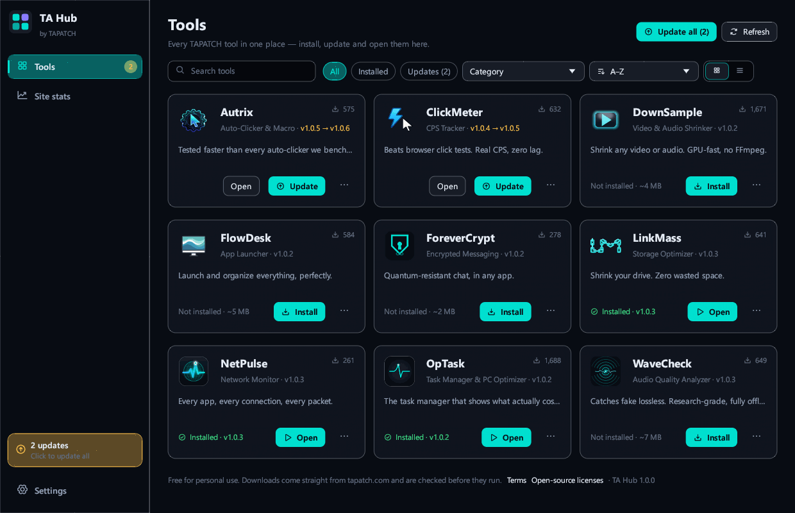
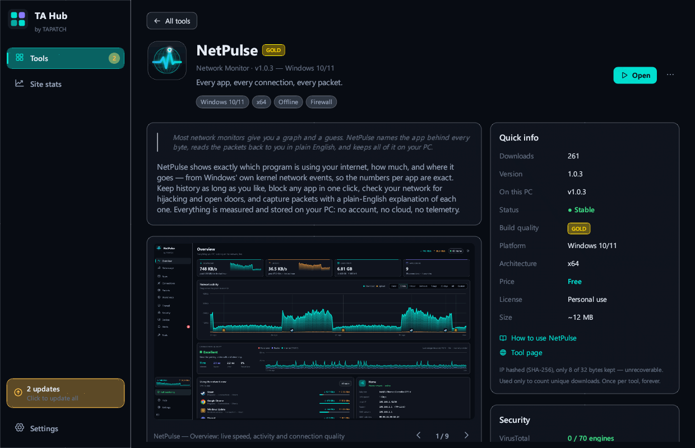
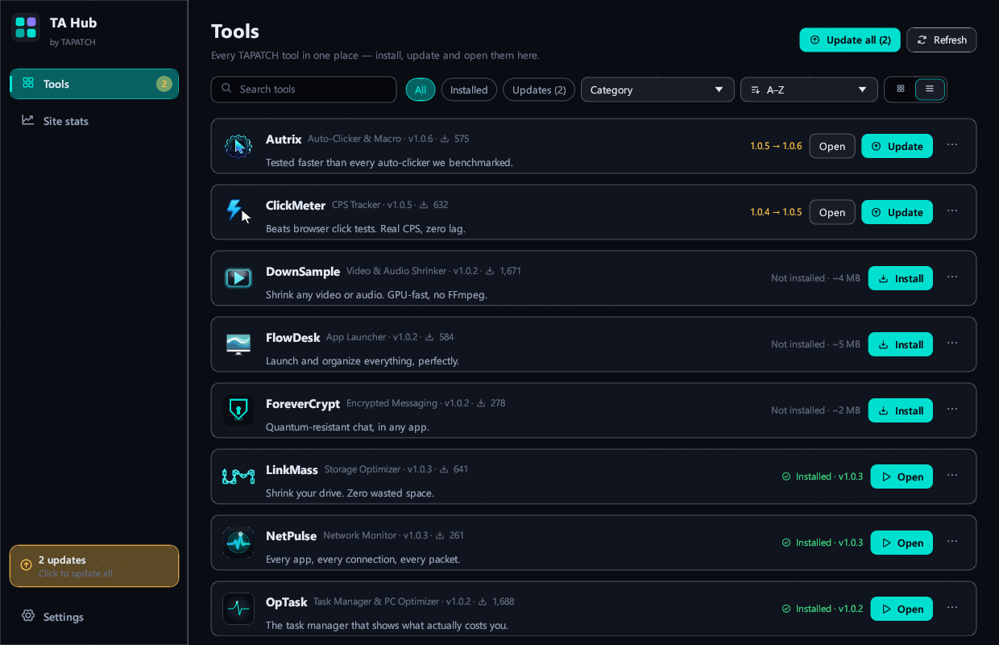
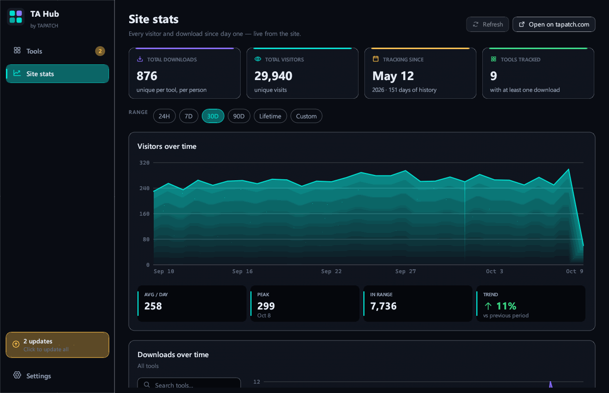
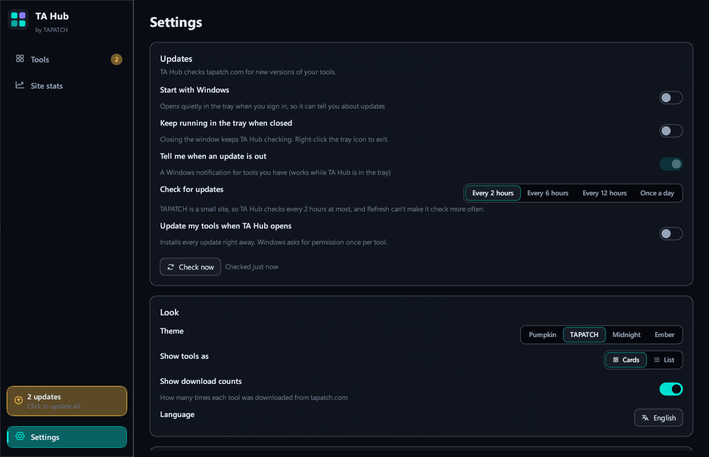

**TA Hub 1.0.3** for Windows 10/11 (x64) · Free for personal use

### What's new

- Now opens in virtual machines, Remote Desktop and on PCs without a graphics driver: it switches to Direct3D 12 when OpenGL doesn't work
- If the window still can't open, a message says why instead of the app closing without a word

### Screenshots

 
  
 

### Download

**`TAHub-Setup-1.0.3.exe`** is attached below. It is the same file as on [tapatch.com/tools/tahub](https://tapatch.com/tools/tahub/).

### Security

- VirusTotal: **0 / 71** engines flag it · [view report](https://www.virustotal.com/gui/file/ba0a2ba2b2992db3dc5e6c4215c05b1d749a294bb417ed385577e61dcc0f48fc/detection)
- SHA-256: `ba0a2ba2b2992db3dc5e6c4215c05b1d749a294bb417ed385577e61dcc0f48fc`

*First released on tapatch.com on 2026-11-11.*

---
Free for personal use. Business or commercial use requires a paid license (see [tapatch.com/terms](https://tapatch.com/terms/)).
