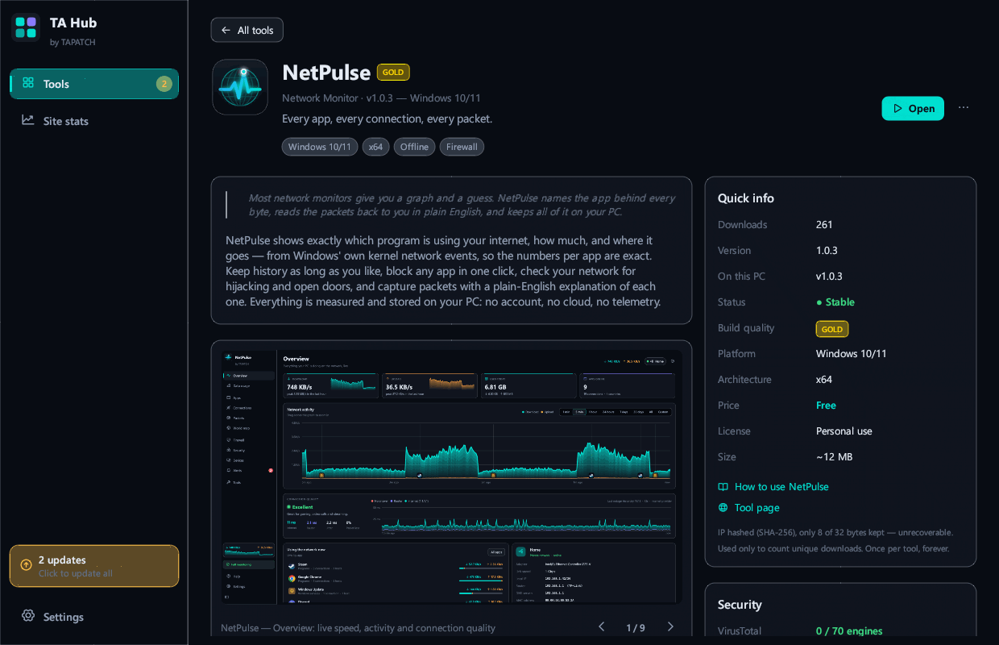
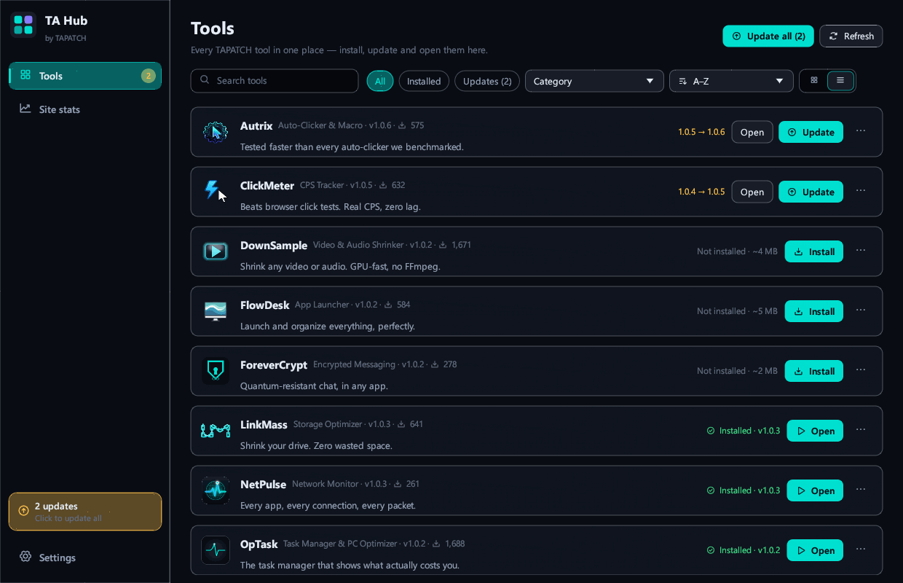
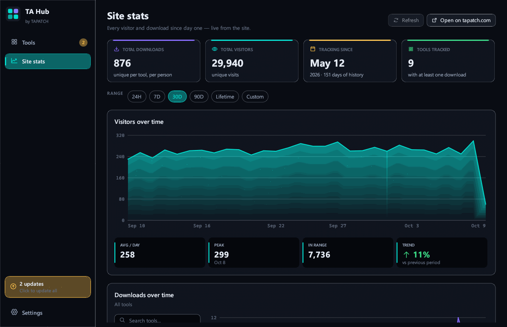
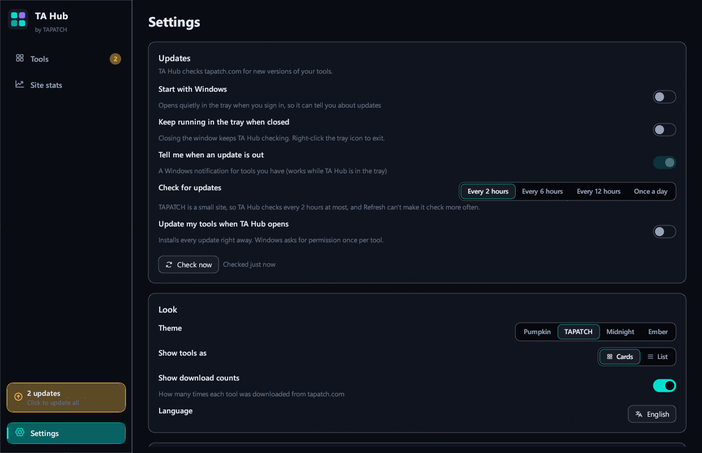

**TA Hub 1.0.4** for Windows 10/11 (x64) · Free for personal use

### What's new

- Tool pages no longer show the video's title as an extra line at the bottom

### Screenshots

 
  
 

### Download

**`TAHub-Setup-1.0.4.exe`** is attached below. It is the same file as on [tapatch.com/tools/tahub](https://tapatch.com/tools/tahub/).

### Security

- VirusTotal: **0 / 71** engines flag it · [view report](https://www.virustotal.com/gui/file/ffbaf9364965b8333a69fae11d9f12e9cbc034a1ffe5ef2576018f4206bf0c1c/detection)
- SHA-256: `ffbaf9364965b8333a69fae11d9f12e9cbc034a1ffe5ef2576018f4206bf0c1c`

*First released on tapatch.com on 2026-11-15.*

---
Free for personal use. Business or commercial use requires a paid license (see [tapatch.com/terms](https://tapatch.com/terms/)).
