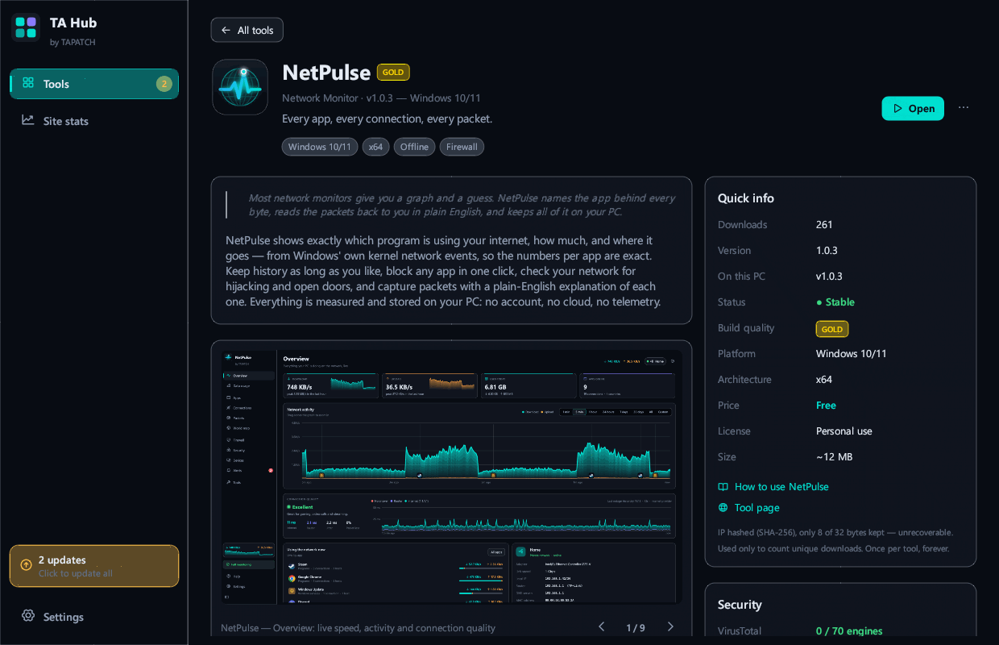
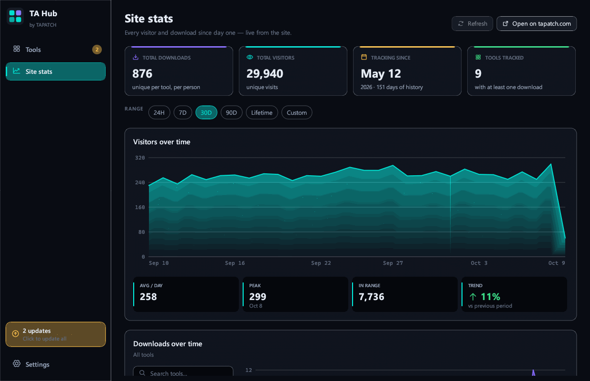
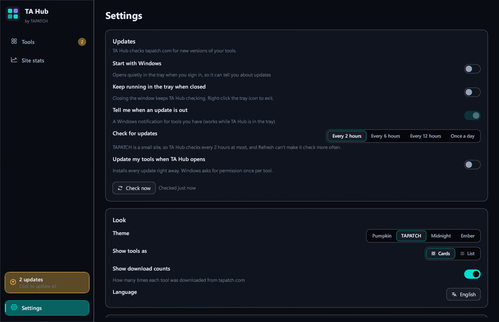

**TA Hub 1.0.5** for Windows 10/11 (x64) · Free for personal use

### What's new

- Tool videos now show their YouTube title, the same as on the website

### Screenshots

 
  
 

### Video

### Download

**`TAHub-Setup-1.0.5.exe`** is attached below. It is the same file as on [tapatch.com/tools/tahub](https://tapatch.com/tools/tahub/).

### Security

- VirusTotal: **0 / 71** engines flag it · [view report](https://www.virustotal.com/gui/file/eecfc1e94a64642a6a7f106cb77e4b3cdd00841554841c448fb37a3eae003077/detection)
- SHA-256: `eecfc1e94a64642a6a7f106cb77e4b3cdd00841554841c448fb37a3eae003077`

*First released on tapatch.com on 2026-11-17.*

---
Free for personal use. Business or commercial use requires a paid license (see [tapatch.com/terms](https://tapatch.com/terms/)).
