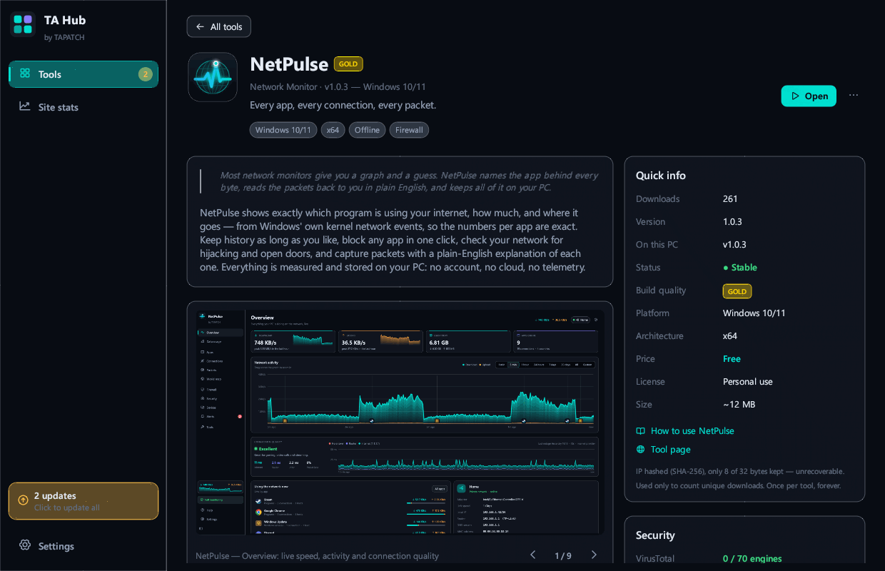
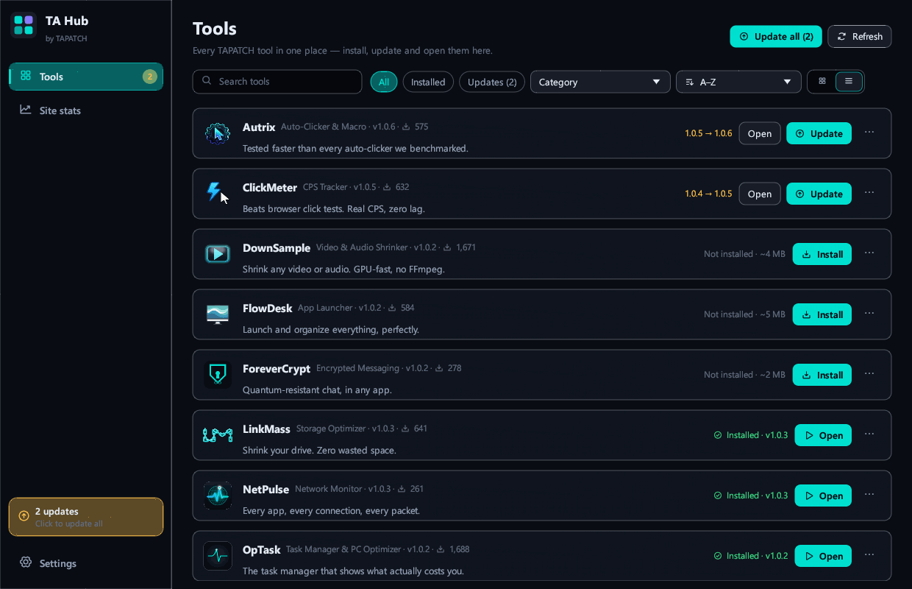
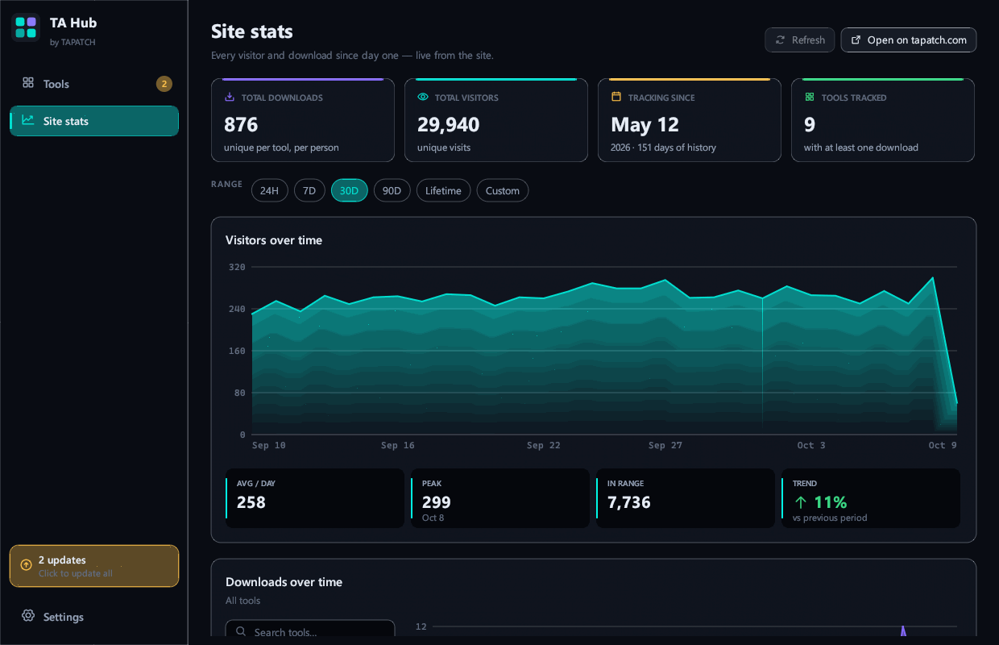
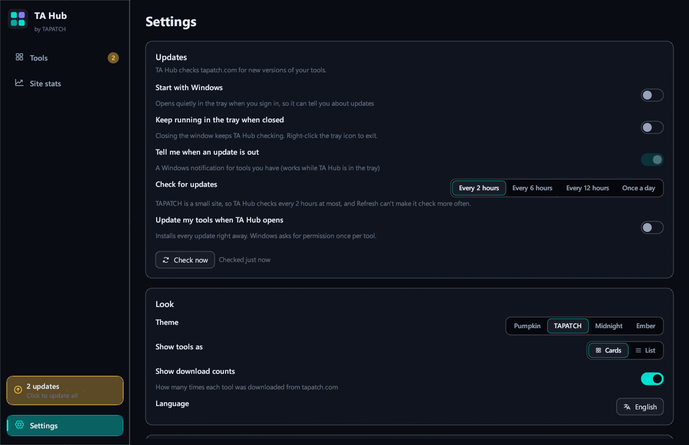

**TA Hub 1.0.6** for Windows 10/11 (x64) · Free for personal use

### What's new

- Older versions install right from the list: open the ⋯ menu on any tool and pick a version
- Hovering an older version shows what changed in it

### Screenshots

 
  
 

### Video

### Download

**`TAHub-Setup-1.0.6.exe`** is attached below. It is the same file as on [tapatch.com/tools/tahub](https://tapatch.com/tools/tahub/).

### Security

- VirusTotal: **0 / 71** engines flag it · [view report](https://www.virustotal.com/gui/file/712a4727a8c2cb263ec8922216fa38e6dab3a9b903933042517ca42ba76c7192/detection)
- SHA-256: `712a4727a8c2cb263ec8922216fa38e6dab3a9b903933042517ca42ba76c7192`

*First released on tapatch.com on 2026-11-22.*

---
Free for personal use. Business or commercial use requires a paid license (see [tapatch.com/terms](https://tapatch.com/terms/)).
