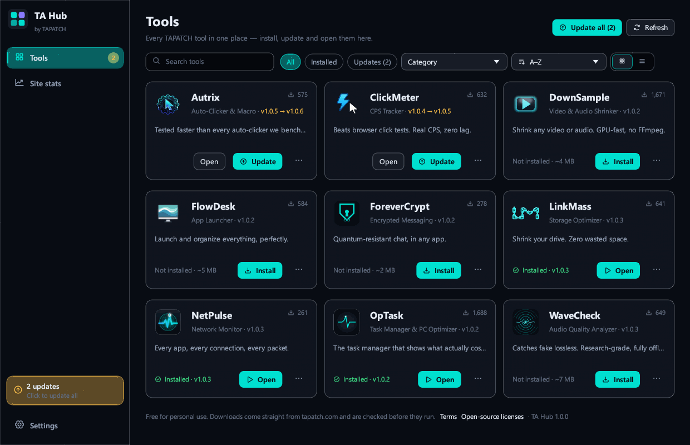
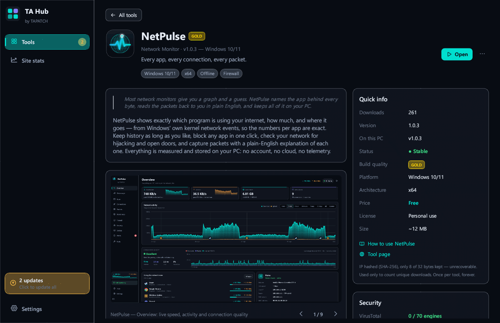
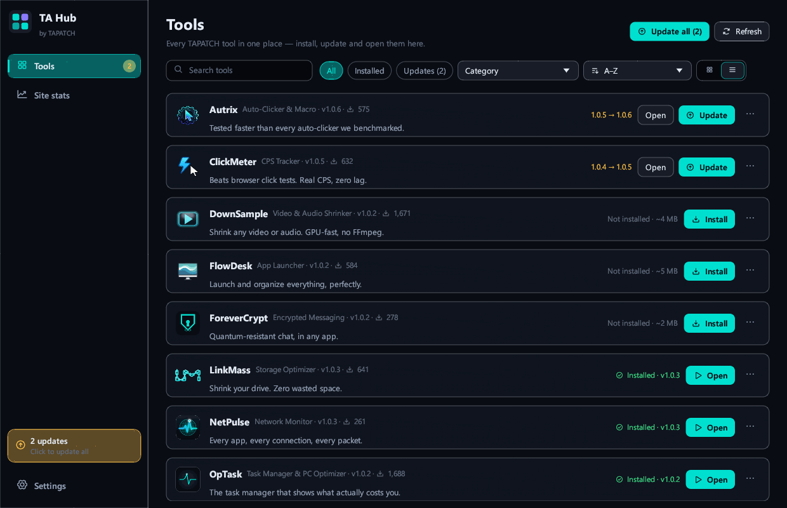
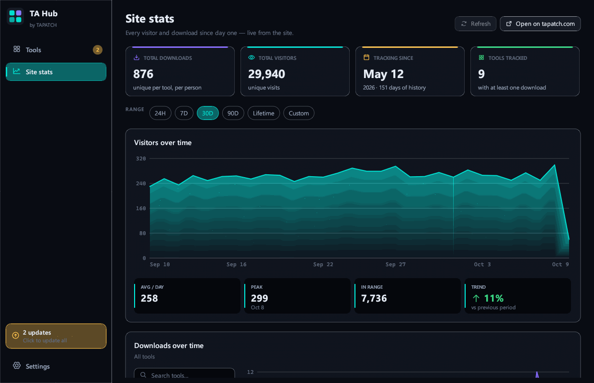
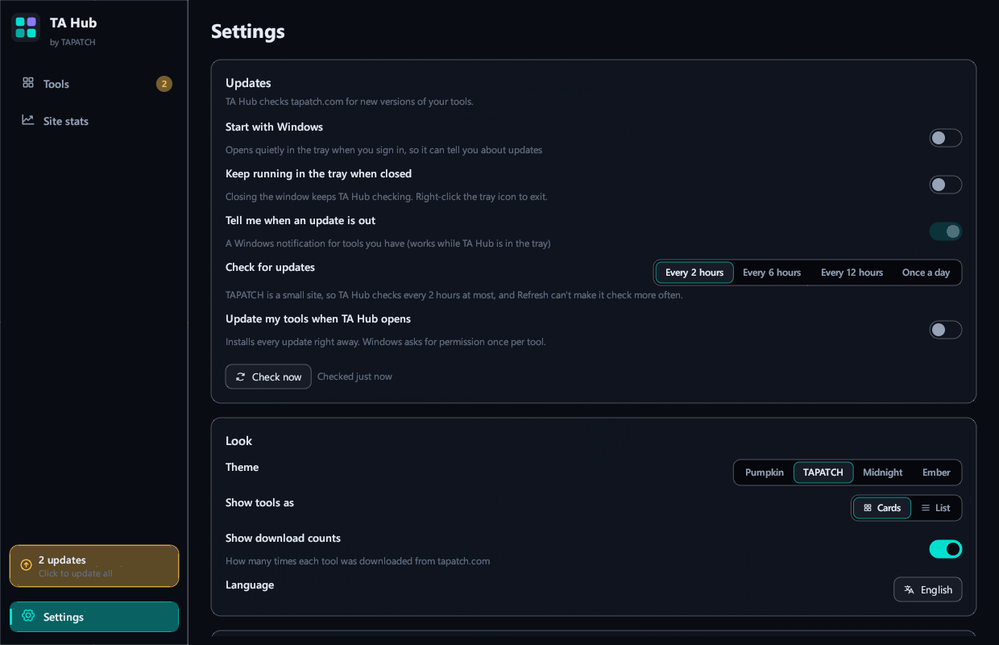

**TA Hub 1.0.7** for Windows 10/11 (x64) · Free for personal use

### What's new

- Same font and text sizes as the other TAPATCH apps
- New UI size in Settings → Size and window: text, buttons and panels get bigger or smaller together (60–200%). Ctrl + and Ctrl − work too, Ctrl 0 goes back to 100%
- The window opens where you left it, on the same screen and at the same size. Or pick Full screen under When the window opens

### Screenshots

 
  
 

### Video

### Download

**`TAHub-Setup-1.0.7.exe`** is attached below. It is the same file as on [tapatch.com/tools/tahub](https://tapatch.com/tools/tahub/).

### Security

- VirusTotal: **0 / 67** engines flag it · [view report](https://www.virustotal.com/gui/file/c85a1e025063ecfcb3261b84dad980faa58b526dbba86a9773c293bb5b240194/detection)
- SHA-256: `c85a1e025063ecfcb3261b84dad980faa58b526dbba86a9773c293bb5b240194`

*First released on tapatch.com on 2026-11-27.*

---
Free for personal use. Business or commercial use requires a paid license (see [tapatch.com/terms](https://tapatch.com/terms/)).
